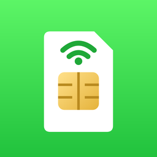

# REGISTER

‏**تماس و پیامکِ سیم‌کارت گوشی اندروید، روی آیفون**

## ‏REGISTER چیست؟

‏آیفونی دارید که رجیستر نشده و سیم‌کارت روی آن کار نمی‌کند؟ REGISTER سیم‌کارت گوشی اندروید شما را به آیفون می‌آورد.

‏گوشی اندروید با سیم‌کارت در کیف یا روی میز می‌ماند و شما همه‌چیز را از آیفون انجام می‌دهید: جواب دادن و گرفتن تماس، فرستادن و خواندن پیامک، دیدن مخاطبین و سابقهٔ تماس. دو گوشی با **بلوتوث رمزنگاری‌شده** مستقیم به هم وصل می‌شوند و **هیچ سرور و اینترنتی** در کار نیست.

## ‏امکانات

| | |
| ---: | ---: |
| ‏📞 **تماس** | ‏تماس ورودی روی آیفون زنگ می‌خورد (مثل تماس عادی آیفون). جواب دادن، گرفتن، قطع کردن، بلندگو و بی‌صدا. |
| ‏💬 **پیامک** | ‏خواندن و فرستادن پیامک با ظاهری شبیه برنامهٔ پیام‌های آیفون. |
| ‏👥 **مخاطبین و سابقه** | ‏مخاطبین و سابقهٔ تماس گوشی اندروید روی آیفون. |
| ‏🔇 **صدای تمیز** | ‏وقتی با آیفون حرف می‌زنید، میکروفون و گوشیِ اندروید خاموش می‌شوند تا صدا دوبار نرود. |
| ‏📱 **سنسور نزدیکی** | ‏وقتی با خود اندروید جواب می‌دهید، صفحه کنار گوش خاموش می‌شود. |
| ‏🌐 **اینترنت** | ‏استفاده از اینترنت گوشی اندروید روی آیفون (هات‌اسپات، بلوتوث و VPN). |
| ‏🌗 **ظاهر** | ‏فارسی با فونت وزیرمتن، راست‌چین، حالت روشن و تیره. |
| ‏🔄 **آپدیت آسان** | ‏آپدیت‌های اندروید بدون حذف برنامه نصب می‌شوند؛ دکمهٔ «بررسی آپدیت» در هر دو برنامه. |

## ‏چه چیزهایی لازم است؟

- ‏یک **گوشی اندروید** با سیم‌کارت رجیسترشده، اندروید ۱۰ یا جدیدتر (برای صدای تماس اندروید ۱۱+).
- ‏یک **آیفون** با IOS 16 یا جدیدتر.
- ‏برای نصب روی آیفون: یکی از برنامه‌های **FEATHER**، **SIDELOADLY**، **ALTSTORE** یا **SIDESTORE** (نیازی به مک نیست).
- ‏یک بار **WI-FI** برای فعال کردن اشکال‌زدایی بی‌سیم روی اندروید (برای رساندن صدای تماس).

## ‏دانلود

‏از صفحهٔ **[نسخه‌ها (RELEASES)](https://github.com/cy33r/REGISTER/releases)** این دو فایل را بگیرید:

| ‏فایل | ‏روی کدام گوشی |
| ---: | ---: |
| ‏`REGISTER-Android-….apk` | ‏گوشی اندروید دارای سیم‌کارت |
| ‏`REGISTER-iPhone-…-unsigned.ipa` | ‏آیفون (با FEATHER یا برنامهٔ مشابه امضا و نصب کنید) |

## ‏راه‌اندازی در ۴ قدم

1. ‏**اندروید:** فایل APK را نصب کنید، REGISTER را باز کنید و مراحل «راه‌اندازی» را از بالا به پایین انجام دهید تا همه سبز شوند.
2. ‏**آیفون:** فایل IPA را با FEATHER (یا برنامهٔ مشابه) نصب کنید و برنامه را باز کنید.
3. ‏**جفت کردن:** در اندروید «جفت کردن آیفون» را بزنید و کد QR را با دوربین آیفون اسکن کنید.
4. ‏**تمام!** حالا تماس‌ها و پیامک‌ها روی آیفون می‌آیند. گوشی اندروید را نزدیک خودتان (در فاصلهٔ بلوتوث) نگه دارید.

## ‏حریم خصوصی و امنیت

- ‏اطلاعات **فقط بین دو گوشی خودتان** جابه‌جا می‌شود؛ هیچ سرور، حساب کاربری یا ردیابی‌ای وجود ندارد.
- ‏ارتباط با **کلید اختصاصی هر جفت** رمزنگاری می‌شود (P-256 و AES-GCM)؛ دستگاه دیگری نمی‌تواند وصل شود یا شنود کند.
- ‏برنامه‌ها خودشان چیزی به اینترنت نمی‌فرستند؛ دکمهٔ «بررسی آپدیت» فقط همین صفحه را در مرورگر باز می‌کند.
- ‏گزارش مشکل (برای عیب‌یابی) بدون شماره‌ها، نام‌ها و متن پیام‌ها ساخته می‌شود.
- ‏کد کامل برنامه همین‌جاست و هر نسخه مستقیماً توسط GITHUB ACTIONS از روی همین کد ساخته می‌شود.

## ‏پرسش‌های رایج

<b>‏آیا گوشی اندروید باید همیشه روشن و نزدیک باشد؟</b>

‏بله. سیم‌کارت روی گوشی اندروید کار می‌کند و آیفون از طریق بلوتوث به آن وصل است؛ پس اندروید باید روشن و در فاصلهٔ چند متری باشد (مثلاً در کیف یا جیب).

<b>‏اگر برنامه را در آیفون از لیست برنامه‌ها ببندم چه می‌شود؟</b>

‏REGISTER در پس‌زمینه و با صفحهٔ قفل وصل می‌ماند، اما اگر آن را با کشیدن به بالا ببندید، تا باز کردن دوباره قطع می‌شود.

<b>‏چرا یک بار WI-FI لازم است؟</b>

‏برای رساندن صدای تماس، اندروید باید «اشکال‌زدایی بی‌سیم» را یک بار جفت کند و این کار فقط با WI-FI ممکن است. بعد از آن WI-FI لازم نیست.

<b>‏آپدیت را چطور نصب کنم؟</b>

‏در هر دو برنامه بخش «درباره» › «بررسی آپدیت» را بزنید. فایل جدید اندروید را روی همان برنامه نصب کنید (بدون حذف) و فایل آیفون را با FEATHER دوباره نصب کنید؛ اطلاعات و جفت شدن حفظ می‌شوند.

<b>‏مشکلی پیش آمد، چه کنم؟</b>

‏در برنامه «ارسال گزارش مشکل» را بزنید و فایل گزارش را در بخش [ISSUES](https://github.com/cy33r/REGISTER/issues) بفرستید.

## ‏مجوز

‏این پروژه متن‌باز است و با مجوز [MIT](LICENSE) منتشر می‌شود. فونت [وزیرمتن](https://github.com/rastikerdar/vazirmatn) با مجوز SIL OFL استفاده شده است.

## ‏حمایت مالی ❤️

‏اگر REGISTER به کارتان آمده و دوست دارید از ادامهٔ کار حمایت کنید، می‌توانید به یکی از این نشانی‌ها کمک کنید. هر مبلغی ارزشمند است.

| ‏ارز | ‏نشانی |
| ---: | ---: |
| ‏**تتر (USDT)** — شبکهٔ BEP20 | `0x79d5066C6Aa7a3EDbeEf44dAfe99deDFe6BF43f4` |
| ‏**بیت‌کوین (BTC)** | `bc1qd049lqfkg9p7pqu5j92dxsf4p7et889mduandp` |

‏⚠️ تتر را فقط از شبکهٔ **BEP20** (BNB Smart Chain) بفرستید؛ ارسال از شبکهٔ دیگر ممکن است باعث از دست رفتن مبلغ شود.

